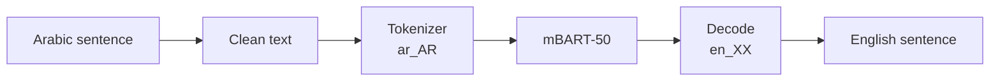

<p align="center">
  
</p>

<p align="center">
  
</p>

<p align="center">
  
  
  
  
</p>

## What is this?

This project translates **Arabic sentences into English**.

It has two parts:

1. **Data preparation**: I cleaned 10,742 Arabic-English sentence pairs, built a word index for each language and split the data into train (80%) and validation (20%).
2. **Translation**: I used **mBART-50** (`facebook/mbart-large-50-many-to-many-mmt`), a pre-trained model from Facebook that knows 50 languages.

## How it works



## Data

`ara_.txt`: 10,742 lines. Each line has an English sentence and its Arabic translation, separated by a tab.

## How to run

```bash
pip install torch transformers sentencepiece tensorflow scikit-learn
```

Open `nmt ara2eng.ipynb` and run all cells.

> The first run downloads the mBART-50 model (about 2.4 GB).

## Next steps

- [ ] Fine-tune mBART on the Arabic-English pairs
- [ ] Measure quality with BLEU
- [ ] Add a small web app

<p align="center">
  
</p>
